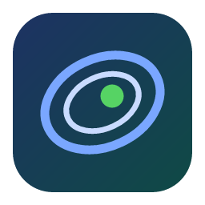
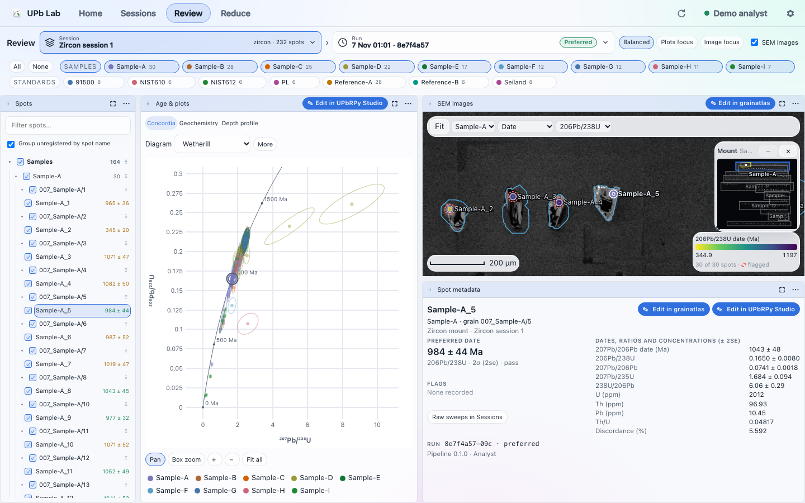
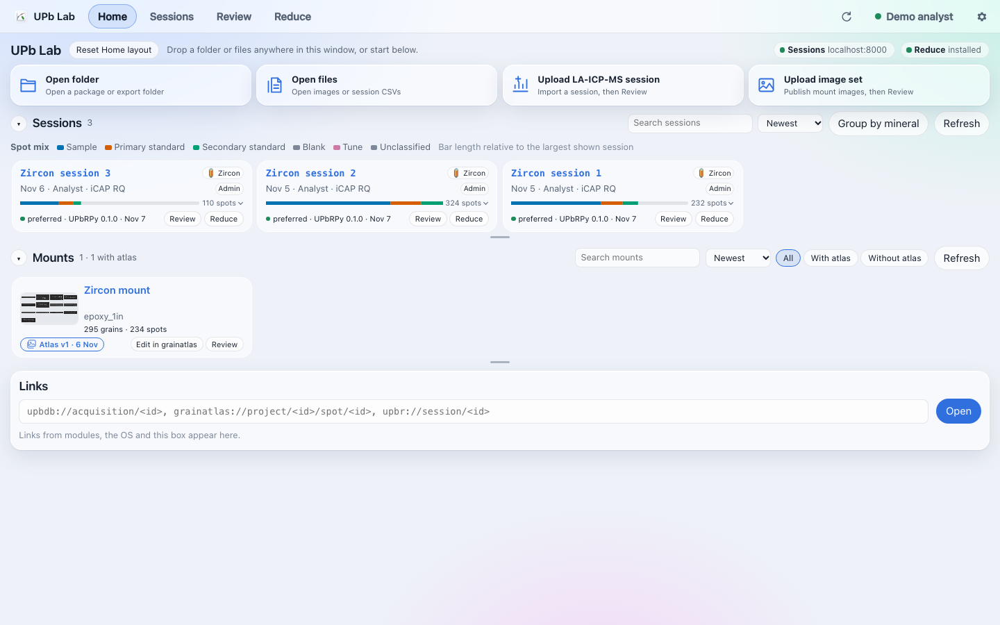
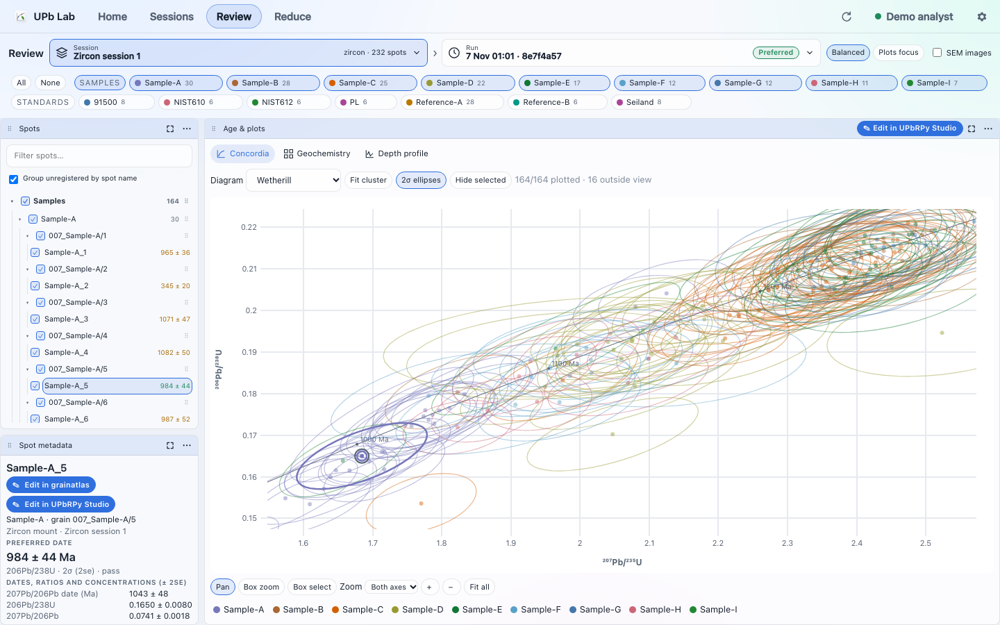
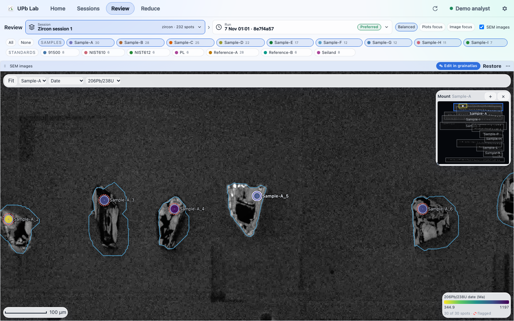

<p align="center">
  
</p>

<h1 align="center">UPb Lab</h1>

<p align="center">One window for the lab's LA-ICP-MS U-Pb workflow</p>

<p align="center">
  <a href="https://github.com/duserzym/upblab/releases/latest">Download</a> ·
  <a href="https://duserzym.github.io/upblab/">Manual</a> ·
  <a href="https://github.com/duserzym/grainatlas">GrainAtlas</a> ·
  <a href="https://github.com/duserzym/UPbRPy">UPbRPy</a> ·
  <a href="https://github.com/duserzym/upb-standards">upb-standards</a>
</p>

<picture>
  <source media="(prefers-color-scheme: dark)" srcset="docs/images/review-images-dark-1440x900.png">
  
</picture>

UPb Lab is the hub app of the University of Minnesota geochronology lab. It
connects GrainAtlas, UPbDB and UPbRPy Studio with one sign-in, and links a spot in
an image to its stored result. UPb Lab does no data reduction; it shows the results
stored in UPbDB.

| Step | App | What happens |
| --- | --- | --- |
| Images | GrainAtlas | Stitch SEM images, segment grains, place spots and publish an atlas. |
| Session upload | UPbDB | Store the laser session and link acquisitions to spots. |
| Reduction | UPbRPy Studio | Reduce the session and submit results to UPbDB. |
| Review | UPb Lab | Read stored results beside their SEM images. |

Screenshots show a real zircon session with sample names, people and places replaced by neutral labels.

## In the app

Tabs are Home, Sessions, Review and Reduce (Ctrl/Cmd 1–4), plus People & access for managers.

### Home

Open folders or files, upload a laser session or image set, and return to sessions, mounts and atlases.
Image folders, `.grainatlas` folders and `.gaproj` files open standalone GrainAtlas on desktop, or its hosted build in a new browser tab.

<picture>
  <source media="(prefers-color-scheme: dark)" srcset="docs/images/home-dark-1440x900.png">
  
</picture>

### Sessions

UPbDB’s web page opens in the Sessions tab, where you confirm session uploads and access stored sessions, spots and reductions.
Uploads accept Rich CSV files, per-spot export folders or zips, including a Rich CSV with its per-spot folder.

<picture>
  <source media="(prefers-color-scheme: dark)" srcset="docs/images/sessions-dark-1440x900.png">
  
</picture>

### Concordia

Plot stored U-Pb results and their 2σ ellipses on Concordia.
Selecting a result selects its linked image spot.

<picture>
  <source media="(prefers-color-scheme: dark)" srcset="docs/images/review-concordia-dark-1440x900.png">
  
</picture>

### Geochemistry

Compare stored results with mineral presets and REE patterns.
Display values derived from stored concentrations are labelled “from stored ppm” and carry no uncertainty; stored columns take precedence.

<picture>
  <source media="(prefers-color-scheme: dark)" srcset="docs/images/review-geochemistry-dark-1440x900.png">
  
</picture>

### Depth profiles

Select a spot to inspect the depth profile stored by its reduction run.
UPb Lab reads stored channels and uncertainties.

<picture>
  <source media="(prefers-color-scheme: dark)" srcset="docs/images/review-depth-dark-1440x900.png">
  
</picture>

### SEM images

The maximised read-only **SEM images** viewer synchronises spot/result selection, shows sample colours and a mount map, and offers **Fit** and area selection.
**Edit in UPbRPy Studio** and **Edit in GrainAtlas** open standalone apps; on the web, GrainAtlas opens in a new tab.

<picture>
  <source media="(prefers-color-scheme: dark)" srcset="docs/images/images-dark-1440x900.png">
  
</picture>

### Sample groups

With **SEM images** enabled and no single spot selected, the mount map outlines each shown sample’s spots in its Review colour and counts samples.
Use sample filters to change the groups; selecting one spot returns the inset to that spot.

<picture>
  <source media="(prefers-color-scheme: dark)" srcset="docs/images/review-groups-dark-1440x900.png">
  
</picture>

### Reduce

**Open in Studio** launches UPbRPy Studio for the selected session with a one-time sign-in.
Return to Review after submitting a reduction to UPbDB.

<picture>
  <source media="(prefers-color-scheme: dark)" srcset="docs/images/reduce-dark-1440x900.png">
  
</picture>

### Settings

Choose the lab server and UPbRPy Studio path, and keep the default System appearance or select Light or Dark.
Check updates and see which module versions the build contains.

<picture>
  <source media="(prefers-color-scheme: dark)" srcset="docs/images/settings-dark-1440x900.png">
  
</picture>

## Install

Download installers for macOS (Apple Silicon) or Windows (x86-64) from
[GitHub Releases](https://github.com/duserzym/upblab/releases/latest).
On macOS, drag UPb Lab to **Applications**; if Gatekeeper blocks it, choose
**Open Anyway** in **System Settings > Privacy & Security**.
For Windows warnings and other steps, see [Installing UPb Lab](docs/installing.md).

If no installer is published yet, follow the prerequisites in the
[build quick start](docs/developing.md#quick-start), then run:

```bash
make setup
make build
```

On first run, choose **Lab server**, enter its address and select **Continue**.
Open **Sign in** in the tab bar, then **Sign in…** to use ORCID or your lab account in the browser.
Choose **Sign UPb Lab in** to return to the app.
Outside the lab network, install [Tailscale](https://tailscale.com/download) and ask the lab manager to share the server and provide its address.

The app checks GitHub releases in the background; **Settings > Updates** offers **Check now**, Stable or Beta channels, and automatic download controls.
Choose **Restart to update** when ready; see [In-app updates](docs/in-app-updates.md).

## Related apps

- **[GrainAtlas](https://github.com/duserzym/grainatlas)**: stitch SEM images of grain mounts, find grains, place laser spots and print sheets.
- **[UPbRPy](https://github.com/duserzym/UPbRPy)**: data reduction engine and desktop Studio for LA-ICP-MS U-Pb and trace elements.
- **[upb-standards](https://github.com/duserzym/upb-standards)**: reference-material values with full citations, used by UPbRPy.
- **UPbDB**: the lab database server for sessions, spots and stored reductions (private).

## For developers

The host uses Rust and Tauri 2; the shell uses Svelte 5 and TypeScript.
After `make setup`, start development and check changes with:

```bash
make dev
make quick
```

See [Developing UPb Lab](docs/developing.md), [Testing](docs/testing.md) and
[the architecture plan](ARCHITECTURE_PLAN.md) for setup, checks and module boundaries.

## License

[MIT](LICENSE).
