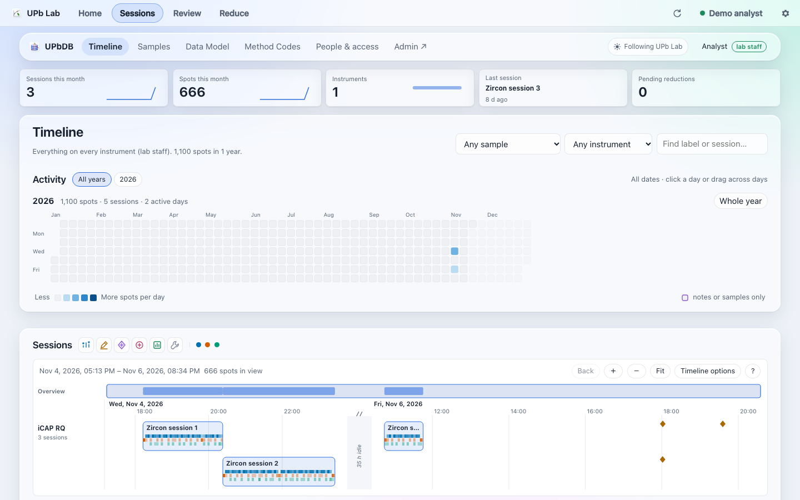
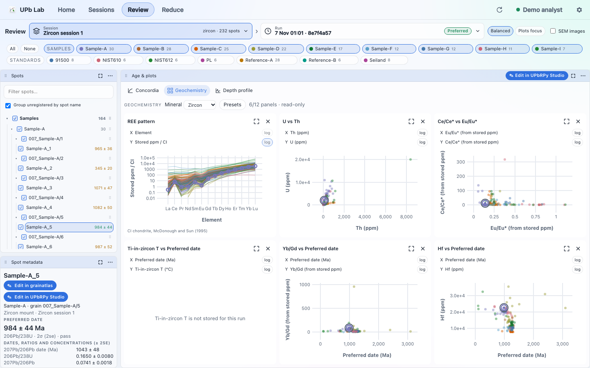
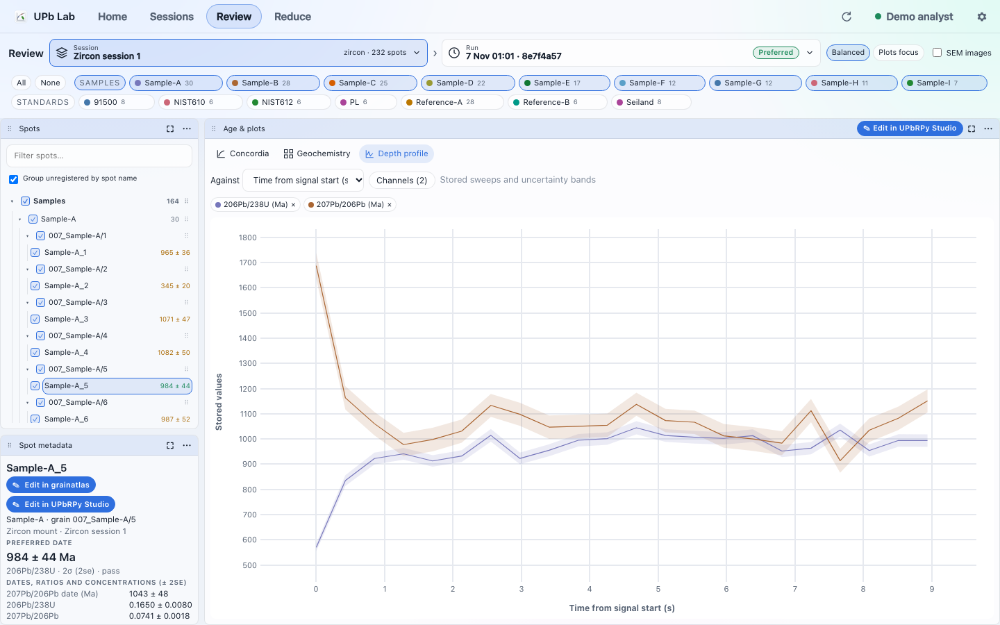
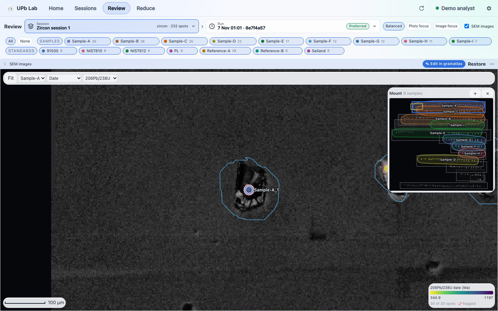
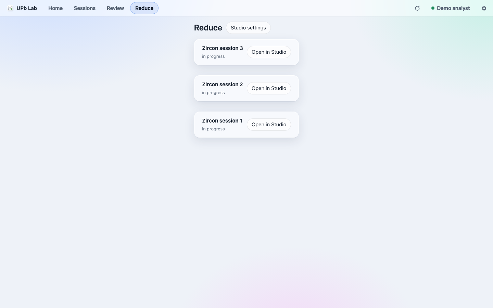
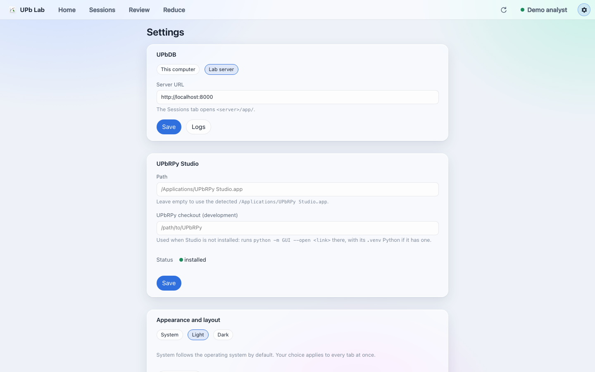

<p align="center">
  
</p>
<h1 align="center">UPb Lab</h1>
<p align="center">One window for the lab’s LA-ICP-MS U-Pb workflow.</p>

UPb Lab is the hub app for the University of Minnesota geochronology lab.
It connects GrainAtlas, the lab database server, UPbDB, and UPbRPy Studio
with one sign-in, and links a spot in an image to its stored result.
GrainAtlas and UPbRPy Studio open as separate applications; on the web,
GrainAtlas’s hosted build opens in a new tab.

UPb Lab does no data reduction. It connects the modules and shows the results
stored in UPbDB.

| Step | App | What happens |
| --- | --- | --- |
| Images | GrainAtlas | Stitch SEM images, segment grains, place spots and publish an atlas. |
| Session upload | UPbDB | Store the laser session and link acquisitions to spots. |
| Reduction | UPbRPy Studio | Reduce the session and submit results to UPbDB. |
| Review | UPb Lab | Read stored results beside their SEM images. |

## In the app

Tabs are Home, Sessions, Review and Reduce (Ctrl/Cmd 1–4), plus People & access
for accounts allowed to manage people.

Screenshots show a real zircon session with sample names, people and places replaced by neutral labels.

### Home

Open folders or files, upload a laser session or image set, and return to sessions, mounts and atlases from one board. **Upload image set**, opened or dropped image folders, `.grainatlas` folders and `.gaproj` files open standalone GrainAtlas on desktop, or its hosted build in a new tab on the web.

<picture>
  <source media="(prefers-color-scheme: dark)" srcset="docs/images/home-dark-1440x900.png">
  
</picture>

### Sessions

The lab database server, UPbDB, stores sessions, spots and reductions. Its web page opens in the Sessions tab, where session uploads are confirmed.

<picture>
  <source media="(prefers-color-scheme: dark)" srcset="docs/images/sessions-dark-1440x900.png">
  
</picture>

### Review: Concordia

Plot stored U-Pb results and their 2σ ellipses on Concordia. Selecting a result selects its linked image spot.

<picture>
  <source media="(prefers-color-scheme: dark)" srcset="docs/images/review-concordia-dark-1440x900.png">
  
</picture>

### Review: geochemistry

Compare stored results on a geochemistry board with mineral presets and REE patterns. Display values derived from stored concentrations are labelled “from stored ppm”; stored columns take precedence.

<picture>
  <source media="(prefers-color-scheme: dark)" srcset="docs/images/review-geochemistry-dark-1440x900.png">
  
</picture>

### Review: depth profile

Select a spot to inspect the depth profile stored by its reduction run. UPb Lab reads stored channels and uncertainties; it does no reduction.

<picture>
  <source media="(prefers-color-scheme: dark)" srcset="docs/images/review-depth-dark-1440x900.png">
  
</picture>

### Review: SEM images beside the plots

Enable **SEM images** to see the published atlas beside the plots and spot details. The bundled GrainAtlas build is a read-only viewer: spots use their sample’s Review colour, and a mount map sits in the corner. **Fit** fits the view; the area menu chooses an area. Selecting a linked spot in the viewer selects its result in Review, and selecting a result focuses its image spot. **Edit in UPbRPy Studio** and **Edit in grainatlas** open the appropriate standalone app to make changes; on the web, GrainAtlas opens in a new tab.

<picture>
  <source media="(prefers-color-scheme: dark)" srcset="docs/images/review-images-dark-1440x900.png">
  
</picture>

### Review: SEM images maximised

Maximise the **SEM images** panel for a closer look at the published atlas.

<picture>
  <source media="(prefers-color-scheme: dark)" srcset="docs/images/images-dark-1440x900.png">
  
</picture>

### Review: sample groups on the mount

With **SEM images** on and no single spot selected, the mount map inset outlines where each shown sample’s spots sit on the mount in that sample’s Review colour. Its header counts the samples. This group view appears after opening a scope, toggling **Group unregistered by spot name**, or using sample chips, sample rows, **All**, **Samples** or **Standards**. Picking a single spot returns the inset to that spot.

<picture>
  <source media="(prefers-color-scheme: dark)" srcset="docs/images/review-groups-dark-1440x900.png">
  
</picture>

### Reduce

**Open in Studio** launches UPbRPy Studio for the selected session with a one-time sign-in. Return to Review after submitting a reduction to UPbDB.

<picture>
  <source media="(prefers-color-scheme: dark)" srcset="docs/images/reduce-dark-1440x900.png">
  
</picture>

### Settings

Choose the lab server, set the UPbRPy Studio path, and select System, Light or Dark appearance. Check updates and see which module versions the build contains.

<picture>
  <source media="(prefers-color-scheme: dark)" srcset="docs/images/settings-dark-1440x900.png">
  
</picture>

## Install and first run

Installers come from [GitHub Releases](https://github.com/duserzym/upblab/releases).
If no installer is published yet, build from source with the prerequisites in
[Developing UPb Lab](docs/developing.md#quick-start):

```bash
make setup
make build
```

On macOS, drag the app to Applications. For an unsigned or not-notarized
download blocked at first launch, open **System Settings > Privacy & Security**
and choose **Open Anyway**. See [Installing UPb Lab](docs/installing.md) for
macOS and Windows instructions.

On first run, choose **Lab server**, enter the lab server’s address and select
**Continue**. Open **Sign in** in the tab bar, then **Sign in…**: this one
button opens UPbDB’s sign-in page in your browser. Use ORCID or your lab
account, then choose **Sign UPb Lab in** to return to the app.

To reach the lab desktop server from outside the lab network, install
[Tailscale](https://tailscale.com/download) and ask the lab manager to share
the lab server with you. Use the address they give you.

## Updates

The app checks GitHub releases in the background. Open **Settings > Updates**
to **Check now**, choose a channel or change automatic downloads; choose
**Restart to update** when ready. See [In-app updates](docs/in-app-updates.md).

## Related repositories and manual

- [GrainAtlas](https://github.com/duserzym/grainatlas): SEM images, grains, spots and atlases.
- The lab database server, UPbDB: sessions, spots and stored reductions.
- [UPbRPy](https://github.com/duserzym/UPbRPy): UPbRPy Studio and data reduction.
- [upb-standards](https://github.com/duserzym/upb-standards): reference material values used in reduction.
- [UPb Lab manual](https://duserzym.github.io/upblab/): installation, screen guides and troubleshooting.

## Development

The host uses Rust and Tauri 2; the shell uses Svelte 5 and TypeScript.
Start with [Developing UPb Lab](docs/developing.md) and [Testing](docs/testing.md).
See [ARCHITECTURE_PLAN.md](ARCHITECTURE_PLAN.md) for the module boundaries and roadmap.

License: [MIT](LICENSE).
